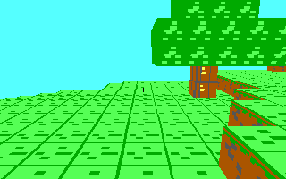
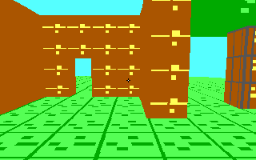

# rdgeneric


rdgeneric is Minecraft rd-132211, the first version Notch ever released (13 May 2009), rewritten as one freestanding C file so that it can be dropped onto any screen. The idea is the one behind [doomgeneric](https://github.com/ozkl/doomgeneric). The core has no includes, no libc calls and no allocation, so a new platform only has to hand it a framebuffer and some key presses.

The shared `src/rd.c` runs in a terminal, over telnet, in a browser as WebAssembly, inside a PDF in Chrome, on a bare x86 PC, and on a jailbroken Kindle Paperwhite 3 as part of [Inkwell](https://github.com/pragyaangaur/Inkwell). This fork additionally runs on a real **Tandy 1000 EX** under 16-bit DOS as the experimental `MINE.EXE` port (see its [actual hardware results](#actual-tandy-benchmarks)). It also compiles for the Raspberry Pi Pico, Pico 2 and Game Boy Advance, though nothing has been run on that hardware yet.

**Play it in your browser: [pragyaangaur.dev/Can-It-Run-Minecraft](https://pragyaangaur.dev/Can-It-Run-Minecraft/)**


## Where it runs

| Target | How the picture gets out | How input gets in | Checked how |
| --- | --- | --- | --- |
| Terminal | Upper half block characters, two pixels per cell, in truecolor, 256 colours or plain ASCII (the `m` key cycles them) | Keys, plus mouse look through SGR mouse reporting | Driven through a pseudo-terminal by a script |
| Telnet, multiplayer | The same, one view per connection, sized from each client's NAWS window report | Telnet in character mode | `tests/telnet_probe.py` rebuilds the screen a client receives |
| Browser | Canvas from a 20 KB wasm module built with plain clang, no Emscripten. The tab's favicon is a second live 32 by 32 view | Pointer lock or drag to look, touch controls on phones | Played in a Chromium pane, 341 by 256 renders in 7.8 ms |
| PDF | 120 text fields, one per row, filled with six character groups that share a width in Chrome's field font | A text field's keystroke action and on-page buttons | Headless Chromium, 8 to 19 fps |
| Bare-metal x86 | VGA mode 13h set by writing the card's registers, 6x6x6 colour cube with ordered dithering | PS/2 keyboard port, which reports key releases | QEMU with its 486, Pentium and qemu32 CPU models |
| Kindle Paperwhite 3 | A 268 by 268 frame scaled 4x onto the e-ink panel, dithered to black and white with a 4 by 4 Bayer matrix so every frame can use the 190 ms A2 refresh, or 16 grey levels with a GRAY button | An on-screen pad on the touchscreen for moving, looking, digging and placing | Played on a real Kindle Paperwhite 3 running [Inkwell](https://github.com/pragyaangaur/Inkwell), whose `src/rd/rd.c` is this file |
| Tandy 1000 EX, 16-bit DOS | Native 160×200 or 320×200, 16-color Tandy graphics | XT/Tandy scan codes; WASD and arrow keys | Open Watcom and DOSBox CI plus a physical 7 MHz V20; measured 0.1–0.3 FPS in tested releases |
| Microcontrollers | Not written yet | Not written yet | Compiles only, see below |


<p align="center"></p>

The PDF works the way [DoomPDF](https://github.com/ading2210/doompdf) does, with one change of route. PDFium runs JavaScript but has no WebAssembly, and DoomPDF dealt with that by building with a 2020 Emscripten that could still emit asm.js. rdgeneric compiles the same C to wasm with clang, then converts the module to plain JavaScript with binaryen's `wasm2js`. The PDF itself is written by `tools/make_pdf.py` with no PDF library. I searched for an earlier Minecraft that runs inside a PDF and found none.

The embedded check below comes from `tools/mcu_check.sh`, which cross-compiles the core with a 32 by 24 by 32 world. RAM here is static data, which is the world, its light map and the generated textures. Apple's clang has no RISC-V backend, so the ESP32-C3 and the BL602 in smart bulbs are not in the table even though the code has nothing that would stop them.

| Target | Code | RAM |
| --- | --- | --- |
| RP2040, Cortex-M0+ (Pico) | 9.2 KB | 50 KB |
| RP2350, Cortex-M33 (Pico 2) | 9.1 KB | 50 KB |
| Game Boy Advance, ARM7TDMI | 9.3 KB | 50 KB |
| 386, no OS | 13.8 KB | 50 KB |

## Building

You need clang and Python 3. The web and PDF builds also need `wasm-ld` and `wasm2js`, and the boot test needs QEMU. On a Mac they all come from Homebrew.

```bash
brew install lld binaryen qemu
```

```bash
make
```

```bash
make test
```

`make` produces `rd-term`, `build/rdgeneric.html`, `build/rdgeneric.pdf` and `build/rdgeneric-x86.elf`. The HTML file has the wasm inlined, so it can be opened straight from disk.

```bash
./rd-term
```

```bash
./rd-term --serve 2323 --level world.dat
```

```bash
telnet localhost 2323
```

```bash
make run-x86
```

The terminal controls are WASD to move, the arrow keys or the mouse to look, space to jump, a click or F to dig, a right click or E to place, 1 to 7 to pick a block, R to respawn, M to change colour mode and Q to quit. In the PDF, click the input box first, then use WASD with IJKL to look. The x86 build also accepts IJKL and the arrow keys. To boot it on a real PC, load the ELF from GRUB with the `multiboot` command.

## Porting

A port is whatever calls these functions. Everything else in `src/rd.h` is optional. If your screen is not listed here, these five calls are the whole job.

```c
rd_init(seed, RD_HILLS);           /* or RD_FLAT for the rd-132211 level */
int me = rd_player_add();
rd_player_input(me, &input);       /* movement, turning, dig, place */
rd_tick();                         /* 60 times a second */
rd_render(me, pixels, w, h, w);    /* 0x00RRGGBB, any size */
```

The renderer casts one ray per pixel through the voxel grid, as Minecraft 4k did, so the cost depends only on the pixel count and the view distance. Nothing is precomputed per resolution, which is why the same call draws a 32 by 32 favicon and a 640 by 400 window. The world size is a compile-time setting. The default is rd-132211's 256 by 64 by 256 (4 MB) and small targets pass `-DRD_X=32 -DRD_Y=24 -DRD_Z=32`.

## The video

The clip at the top is one scripted walk, `src/rd_demo.c`, played on four platforms and cut together so the picture never jumps. The walk starts on a fixed seed and drives the same inputs on every tick. The world is generated in integer maths and every build turns off fused multiply-add (`-ffp-contract=off`), so each platform computes the same game state at every tick. On the 486 build, whose x87 unit keeps floats at 80 bits, the player position stays within a thousandth of a block of the native build for the whole walk.

Every frame in the clip was drawn by the platform shown. The browser frames come from the real page in headless Chromium, and the terminal frames are the bytes `rd-term` wrote to a pseudo-terminal, replayed in xterm.js. The PDF frames are screenshots of Chrome's own PDF viewer running the script, and the bare-metal frames are QEMU screendumps of VGA memory. The PDF and QEMU builds run at 5 to 19 fps in real time on this Mac, so the recorders step every platform one frame at a time and the clip plays them all at 30 fps. The browser window, the terminal window and the beige monitor around the picture are drawn by `tools/record/composite.py`. The PDF viewer around its picture is Chrome's own. A 720p copy is in [docs/rdgeneric.mp4](docs/rdgeneric.mp4).

```bash
make && tools/record/record_all.sh build/rec
```

The same walk is the easiest way to check a new port. Run it, step it two ticks at a time and compare the frames with the browser build.

## How close it is to rd-132211

These parts follow rd-132211's code as it appears in public decompilations. I wrote them from those descriptions and have not checked the constants against the original jar.

| Part | rd-132211 | rdgeneric |
| --- | --- | --- |
| Level | 256 x 256 x 64, solid to two thirds height, grass on top | The same with `RD_FLAT`. `RD_HILLS` adds terrain and trees |
| Timer | 60 ticks a second | The same |
| Movement | Acceleration 0.02 on the ground and 0.005 in the air, gravity 0.005, jump 0.12, drag 0.91 and ground friction 0.8 | The same |
| Collision | Clip y, then x, then z against every cube the move touches | The same |
| Light | A cell is lit when nothing solid is above it | The same, with shadowed faces at 0.6 |
| Face shading | 1.0 on top and bottom, 0.8 on z faces, 0.6 on x faces | The same |
| Sky | Clear colour 0.5, 0.8, 1.0 | The same, slightly paler near the horizon |

Some parts differ on purpose. The textures are generated by code and are not Mojang's terrain.png. There are seven block types where rd-132211 had two. Respawning puts the player on the surface, while rd-132211 dropped them from above the level. Other players appear as simple figures, which rd-132211 never needed because it had no multiplayer. The mouse buttons follow the modern convention. No Mojang code or assets are in this repository.


## Where Minecraft has run before

Minecraft has nothing like Doom's porting history. Doom's source has been public since 1997, while Minecraft's never was. Most "Minecraft on X" projects are therefore clones or ports of the tiny early versions. This is what I found while starting the project.

**Ports and translations of the early versions into C.** [beta-c](https://github.com/betacraftuk/beta-c) translates rd-132211 through Classic 0.0.12a. [RubyC](https://github.com/ilovecodingforsomereason/RubyC) is a C port of rd-132211. [MinecraftC](https://github.com/johnpayne-dev/MinecraftC) is a raytraced port of Classic 0.0.30a. [m4kc](https://github.com/sashakoshka/m4kc) decompiles Minecraft 4k into C with SDL, and [Minecraft4k-CPP](https://github.com/TheSunCat/Minecraft4k-CPP) reworks it for the GPU. [RDForward](https://github.com/martinambrus/RDForward) is a modding toolchain for rd-132211 with Android support, and someone has [ported rd-132211 to the 3DS](https://gbatemp.net/threads/release-rd-132211-old-minecraft-ported-to-the-3ds.680316/).

**ClassiCube**, the biggest effort of this kind. It is a Minecraft Classic client written from scratch in C, and its [repository](https://github.com/ClassiCube/ClassiCube) lists builds for the Switch, Wii, GameCube, Dreamcast, PS1, PS2, PS3, PSP, PS Vita, 3DS, DS, N64, Saturn, Xbox, Wii U, MS-DOS and Classic Mac OS, with very different levels of polish. For running a Minecraft-like game on old consoles it is already the doomgeneric of Minecraft.

**Calculators and handhelds.** On the TI-84 Plus CE there are [Blocks](https://github.com/TheScienceElf/Blocks-TI-84/) by TheScienceElf at about 10 fps, [MineCalc-CE](https://github.com/imatree247/MineCalc-CE) and [Minecraft-CE](https://github.com/TimmyTurner51/Minecraft-CE). An early project aimed at [Minecraft 1.3.2 on the TI-Nspire CX](https://github.com/Nickorama21/Minecraft--TI-Nspire-CX-Port). 3DSage made [GBACRAFT](https://archive.org/details/gbacraft) for the Game Boy Advance, and Game of Tobi got a [3D Minecraft running on the Game Boy Color](https://www.pcgamer.com/hardware/youtuber-gets-minecraft-running-on-an-original-game-boy-color-and-it-even-looks-kinda-playable/) and the original Game Boy.

**Microcontrollers and odd hardware.** [Picocraft](https://yohandev.github.io/portfolio/picocraft/) renders voxels on a Raspberry Pi Pico and an LCD, streaming chunks from a Spigot server. A minimal Minecraft server has run on an [ESP32-C3](https://hackaday.com/2025/09/13/esp32-hosts-functional-minecraft-server/) and on the [BL602 chip in a smart light bulb](https://www.tomshardware.com/maker-stem/microcontrollers/hardware-hacker-installs-minecraft-server-on-a-cheap-smart-lightbulb-single-192-mhz-risc-v-core-with-276kb-of-ram-enough-to-run-tiny-90k-byte-world), with 276 KB of RAM. Both of those run a server and draw nothing. The real game has been shown on a [Tektronix oscilloscope](https://www.youtube.com/watch?v=yIRZrKriqqc) through a VGA to XY adapter, and on a [GPU with 8 MB of video memory](https://tech.yahoo.com/gaming/articles/minecraft-runs-8mb-vram-using-144600508.html).

**Bare metal, terminals and Minecraft itself.** [MineAssemble](https://github.com/Overv/MineAssemble) is a bootable Minecraft clone written partly in x86 assembly, so rdgeneric's x86 build is not the first to boot without an OS. [TermCraft](https://github.com/woliver99/termcraft) is a terminal Minecraft in Rust that uses the same half-block trick and has LAN multiplayer, and [terminal-minecraft](https://github.com/PedroDNBR/terminal-minecraft) does it in C++ for Windows Terminal. Minecraft has also run [inside Minecraft on the CHUNGUS 2 redstone computer](https://hackaday.com/2023/05/27/minecraft-in-minecraft-on-the-chungus-ii/).

## Limitations

None of these is hidden in the code, and each is worth knowing before you build on it.

- No microcontroller port draws anything yet. The table above shows that the core compiles and fits, and it says nothing about frame rate on a 133 MHz Cortex-M0+ with no FPU, where every float is done in software.
- The x86 build has only run in QEMU. On an Apple Silicon Mac, QEMU emulates every x86 instruction, which gives 5 to 10 fps on the 486 model and about 9 fps on qemu32. Real hardware should be faster, but that has not been measured.
- Most terminals never report key releases, so a key counts as held for 0.6 s after the first press and 0.12 s after each repeat. Movement keeps going briefly after you let go. Terminals that speak the kitty keyboard protocol report releases, and rd-term switches to exact timing when it sees that support. The status line says which mode is in use.
- The PDF needs a Chromium browser. Firefox, Preview and Acrobat do not run its script. It renders in six shades of grey at 8 to 19 fps.
- The telnet server sends a full colour frame per client, at up to 30 fps, with only changed cells redrawn. That is fine on a LAN and heavy over a slow link, where 256-colour mode (the `m` key) helps.
- Raw-block saving is supported in the terminal build (`--level`) and the 16-bit DOS port (`MINE.WLD`). rd-132211 gzipped its `level.dat`; back up `MINE.WLD` before trying experimental DOS releases.

## Layout

```
src/rd.h, src/rd.c        the core
platforms/term/           terminal and telnet server
platforms/web/            wasm glue and the HTML page
platforms/pdf/            the script that runs inside the PDF
platforms/baremetal/      Multiboot kernel for x86
platforms/dos16/          Tandy 1000 EX DOS entry point, video, keys, HUD and minimap
tools/                    PDF writer, wasm inliner, snapshot renderer, embedded size check
tests/run.sh              builds everything and checks each target
```

## MINE.EXE: Tandy 1000 EX / V20

> **Experimental proof of concept, not a playable 3D Minecraft port on the tested hardware.** We achieved recognizable Tandy 16-color Minecraft graphics, but the best-looking renderer was much too slow. The later hybrid ran faster but looked substantially worse. Our **2 FPS minimum was not reached**, and active optimization for unrestricted V20 3D has been paused.

This fork ports the early `rdgeneric` / rd-132211-inspired C voxel world to a **Tandy 1000 EX with a 7 MHz NEC V20**, DOS and native 16-color Tandy graphics. Open Watcom produces a real-mode 16-bit, 8086-compatible executable, `MINE.EXE`. It is not a port of modern Java Minecraft. The DOS world is 32×24×32 blocks.

**[Download the latest MINE.EXE release](https://github.com/ARMoir/Tandy-Minecraft/releases/latest)**. Extract the full ZIP, including `MINE.PIC` if using the static artwork display. This project uses **`main` as its only active development branch**, not a separate `master` branch.

### Actual Tandy benchmarks

These numbers come from the **physical 7 MHz V20**, as photographed and tested on the user's machine. Build #27 and Build #32 use different renderers, output modes and frame counts, so the results show progress and the tradeoff, **not a strict matched-workload speedup**.

| Build/milestone | Measured physical behavior | Finding |
| --- | --- | --- |
| Original 3D attempts | First frame could take minutes, with little apparent movement | Expensive runtime generation and per-pixel 3D were impractical |
| Precomputed-world, simplified terrain iterations | Startup improved to **under 4 seconds**; the scene was often unrecognizable | Startup was solved, but visual clarity was not |
| **Build #27 — best live graphics** | **7 frames in 1,141 BIOS ticks (displayed 0.1 FPS)**; setup 14, rendering 904, video 132 ticks | Beautiful real cube faces, trunks, grass and depth, but unusably slow |
| **Build #32 — speed-focused hybrid** | **4 frames in 201 BIOS ticks (displayed 0.3 FPS)**; setup 13, rendering 167, video 12 ticks | Much less rendering/video work, but the graphics reverted to coarse, ambiguous terrain |

One BIOS tick is approximately 1/18.2 second. The frame rates above are the **rounded FPS displayed by MINE.EXE**. The hybrid was still roughly **6–7× short of the 2 FPS target**, and far from the original 10 FPS ambition. We should not describe this as a playable port.

The automated DOSBox comparison, with a fixed 20,000-cycle setting, produced about **6 ticks for four frames** with a full-face baseline and **5 ticks** with the later hybrid. DOSBox is useful for identical-build comparisons, regression tests and correctness; **its frame rate does not predict the real V20**.

### How to get the beautiful Build #27-style graphics back





The **full textured exposed-face renderer is still included in the latest executable**. It is selected with:

```dos
MINE.EXE /FACES /MAX
```

This requests **live 320×200, 16-color Tandy mode 09h**, grass tops, dirt and stone sides, trees, openings, shaded block faces, and other full 3D geometry. It remains **extremely slow** on the V20. The renderer has since received optimizations; it **may not be pixel-identical to the original Build #27**, although it is the closest preserved live graphics mode. `/FACES /MID` uses the same face engine at a lower resolution.

If you only want to see the artwork without waiting for live 3D:

```dos
MINE.EXE /ART
```

`/ART` loads the pre-generated `MINE.PIC` included in the full ZIP, showing a **static 320×200** image. This is a visual demonstration, **not** an interactive game or benchmark.

### Current command reference

| Command | What it actually does |
| --- | --- |
| `MINE.EXE` or `MINE.EXE /LOW` | **Default hybrid**, nearby textured cubes plus cached coarse distant terrain; internal **80×50**, output using Tandy **mode 08h** (160×200) |
| `MINE.EXE /MID` | Hybrid **80×100**, mode 08h |
| `MINE.EXE /DETAIL` | Hybrid **160×100**, mode 09h |
| `MINE.EXE /MAX` | Hybrid **160×200**, mode 09h — **not** the full-quality Build #27 renderer |
| `MINE.EXE /HYBRID` | Explicitly select the hybrid engine |
| **`MINE.EXE /FACES /MAX`** | **Full exposed-face 3D at 320×200**, mode 09h — closest to the Build #27 visuals |
| `MINE.EXE /FACES /MID` | Same face renderer, **160×100**, mode 09h |
| `MINE.EXE /TERRAIN` | Earlier fast but inaccurate heightfield |
| `MINE.EXE /FULL` | Older per-pixel 3D DDA engine (not the same as `/FACES`) |
| `MINE.EXE /OLD` | Original integer ray marcher |
| `MINE.EXE /ART` | Static pre-rendered scene; requires `MINE.PIC` |
| `MINE.EXE /LOW /BENCH` | Four auto-rotating frames and measured timing, **without saving** |
| `MINE.EXE /KEYTEST` | Raw hardware keyboard diagnostic |

The flags may be supplied in either order, e.g. `/MAX /FACES`. For meaningful performance comparisons, match renderer, resolution, world, and camera workload. Benchmark mode **automatically moves the camera**, so it is not a keyboard-response test.

### Keyboard, gameplay and feedback

| Keys | Action |
| --- | --- |
| W/S | Forward/backward |
| A/D | Strafe left/right (**D does not rotate**) |
| Left/Right arrows | Turn the camera |
| Up/Down arrows | Tilt the camera (move the horizon) |
| Space | Jump |
| F/E | Dig/place aimed-at block |
| 1–7 | Select a material |
| R | Respawn |
| H | Cycle image detail |
| Esc/Q | Save and quit |

The DOS input handler was adapted for the Tandy EX's keyboard, XT scan codes and extended arrow prefixes. It latches brief presses during slow frames and scales camera movement with elapsed time. **DIG/PUT** reflects actual block mutation, whereas **MISS/BLOCK** means the action could not be completed. The small minimap shows position and facing direction. In the simplified rendering modes, some successful edits may not be visually apparent because the scene omits remote/vertical block faces.

Normal gameplay reads and writes the raw `MINE.WLD` file in the current directory. **Back up existing worlds before testing**; `/ART`, `/CAPTURE` and `/BENCH` do not overwrite world saves.

### Engineering findings from the experiment

1. **Precompute expensive startup data.** The build host generates the default 32×24×32 world and compresses its **24,576 bytes to approximately 1,590 RLE bytes**, embedded into the EXE. The V20 no longer runs the original expensive procedural terrain generator on each startup.
2. **Bake block artwork before launch.** Source 16×16 textures, shade variants and Tandy palette colors are converted on the host. Naive nearest-RGB colors made green grass look gray and dirt/stone blend together; **material-aware palettes** preserve green grass/leaves, brown dirt/wood and gray stone.
3. **Rendering is the real bottleneck.** Faster heightfield projection produced floating-looking tree canopies, smudged terrain and hidden edits. Full face geometry made Minecraft visibly recognizable but involved too many projected faces, edge operations and texture spans for a 7 MHz V20.
4. **Integer code helps but cannot rescue the full scene alone.** Fixed-point 3D stepping, precalculated perspective/reciprocal tables, 16-bit texture coordinates, exposed-face caching, face-size culling, short draw radii and Open Watcom speed optimization removed some overhead but did not bridge the gap.
5. **VRAM traffic matters.** Bulk packed writes, skipped unchanged scanlines, and **mode 08h's 16 KB framebuffer instead of mode 09h's 32 KB** reduced video-transfer cost. Yet the 3D renderer itself still dominated frame time.
6. **Hybrid speed had a visual price.** Build #32 combined small-radius real voxel faces with a **cached 40×25** distant-heightfield image. It could not match the natural cube silhouettes, terrain edges, and tree depth of the full-face renderer.
7. **Hardware benchmarking decides success.** CI compiles a real 16-bit DOS MZ binary, checks keyboard, world editing, palette and 3D geometry, then runs DOSBox and verifies the DOS framebuffer. These tests prove **correctness**, not playable speed on the physical NEC V20.
8. **Learn from [WolfensteinCGA](https://github.com/jhhoward/WolfensteinCGA)** without assuming its vertical-wall optimizations directly fit unrestricted voxel geometry. Offline conversion, packed indexed artwork, lookup tables and careful video memory writes transferred usefully.

### Relevant source and build files

- [`src/rd.c`](src/rd.c) / [`src/rd.h`](src/rd.h): shared voxel world, physics, block editing and collision.
- [`src/rd_faces.c`](src/rd_faces.c): full textured 3D face renderer preserved by `/FACES`.
- [`src/rd_hybrid.c`](src/rd_hybrid.c): current near-face / distant-heightfield hybrid default.
- [`src/rd_terrain.c`](src/rd_terrain.c): original fast approximate heightfield.
- [`platforms/dos16/mine.c`](platforms/dos16/mine.c): CLI, FPS timing, native Tandy graphics, screen copies and world I/O.
- [`platforms/dos16/mine_keys.c`](platforms/dos16/mine_keys.c), [`mine_hud.c`](platforms/dos16/mine_hud.c), [`mine_map.c`](platforms/dos16/mine_map.c): controls and visible action feedback.
- [`tools/make_face_art.py`](tools/make_face_art.py), [`tools/make_tandy_atlas.c`](tools/make_tandy_atlas.c): prebuilt textures, shaded faces and indexed artwork.
- [DOS workflow](.github/workflows/mine-dos.yml): Open Watcom build, host and DOSBox tests, render previews, release packaging and release cleanup.

Only **`main`** is used for development. The Actions workflow rebuilds on every commit, publishes a new ZIP, and **deletes earlier releases and tags** after a successful publish. Always use the [latest release page](https://github.com/ARMoir/Tandy-Minecraft/releases/latest); prior source **commits remain in Git history** even when their packaged releases are removed. The graphics of the visual milestone are available through `/FACES /MAX` in current releases.

### Conclusion

The project demonstrated that the 7 MHz V20 **can render real shaded Minecraft-style voxel blocks**, run a small editable world, accept movement, and save it to DOS. It did **not** demonstrate a Minecraft game that is enjoyable at interactive frame rates. Build #27's full 3D view was compelling but reached only **0.1 FPS** in the recorded hardware test; Build #32 reached **0.3 FPS** at the cost of legibility. **The 2 FPS requirement was not met.**

A future revival would need a substantially different design—perhaps **pre-rendered scenery tiles, fixed viewpoint steps, a small authored level, sprite assembly, or very constrained 3D**—and would necessarily trade away part of unrestricted Minecraft-style movement. Another round of minor tweaks to the existing face renderer is unlikely to solve the fundamental workload.

**Preserve the source, the measured results, `/FACES /MAX` for the best live graphics, and `/ART` for the static full-resolution demonstration. Do not present the V20 project as a playable Minecraft port.**
